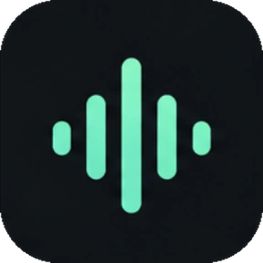
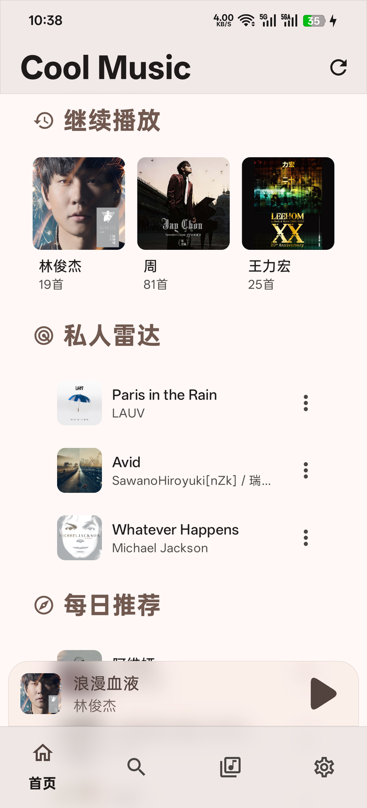
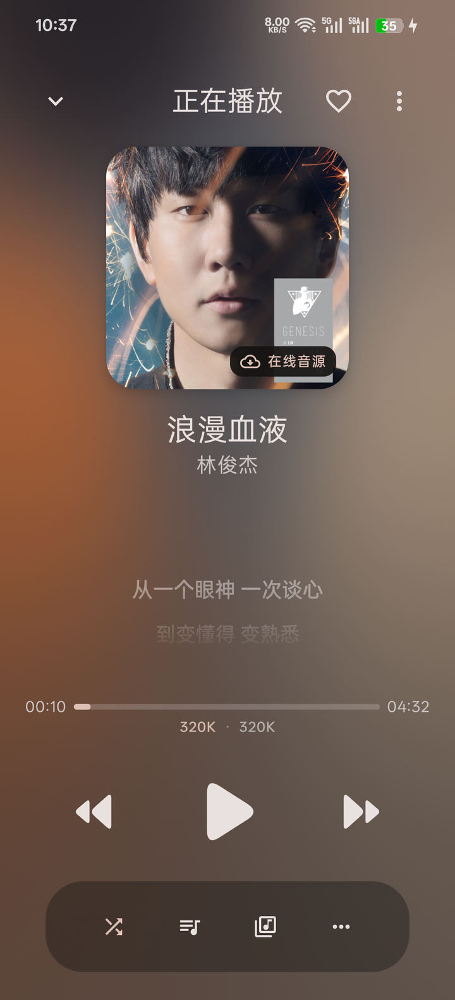
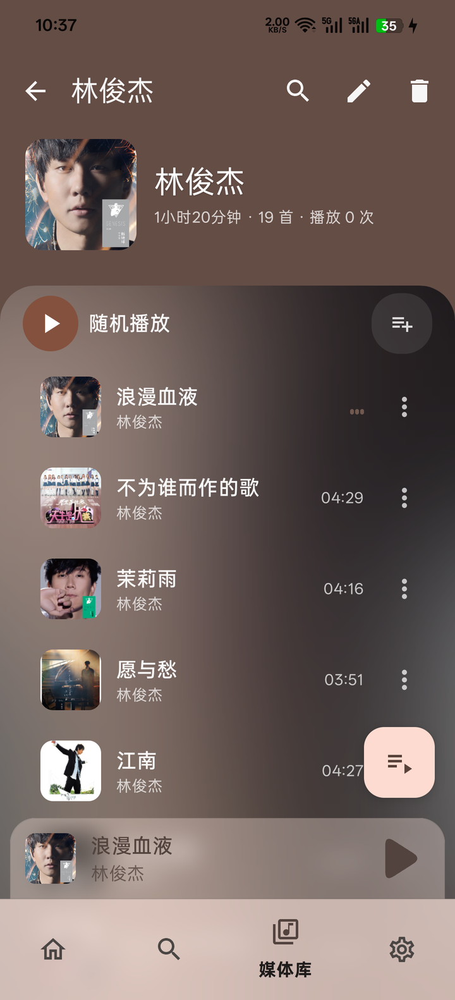
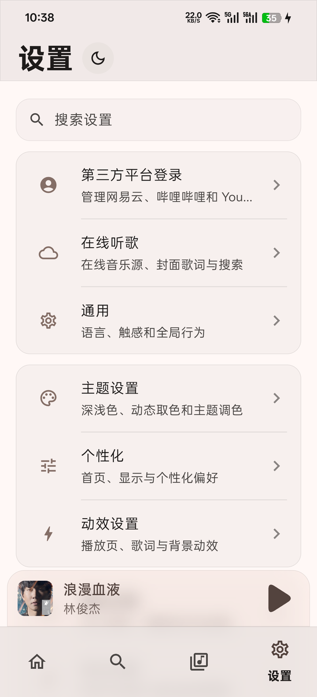

<p align="center">
  
</p>

<h1 align="center">Cool Music</h1>

<p align="center">
  一个本地优先的多源音乐播放器：在线音源取流、歌词封面补全，数据都留在你自己手里
</p>

<p align="center">
  <a href="https://github.com/octagoningly/Cool-Music/releases"></a>
  
  
  
  
  
</p>

<p align="center">
  <a href="https://github.com/octagoningly/Cool-Music/releases/latest"><b>下载 APK（GitHub）</b></a>
  &nbsp;·&nbsp;
  <a href="更新记录.md">更新记录</a>
  &nbsp;·&nbsp;
  <a href="开发规则.md">开发规则</a>
  &nbsp;·&nbsp;
  <a href="CONTRIBUTING.md">贡献指南</a>
</p>

<p align="center">
  <sub>基于 <a href="https://github.com/cwuom/NeriPlayer">NeriPlayer</a> 的 GPL-3.0 衍生版，包名独立（<code>moe.ouom.coolmusic</code>），可与上游共存安装。<br />
  在线音源依赖你自己配置的第三方接口 / 脚本；本项目不内置、不维护任何公共曲库。</sub>
</p>

---

## 界面截图

<p align="center">
  
  &nbsp;&nbsp;
  
  &nbsp;&nbsp;
  
</p>

<p align="center">
  
  &nbsp;&nbsp;
  
  &nbsp;&nbsp;
  
</p>

左起：**首页**（继续播放 / 私人雷达 / 每日推荐，次级板块收进「更多」）、**探索**
（多引擎免登录搜索 + 精品歌单网格）、**媒体库**（本地 / 收藏 / 网易云 / B站 / YouTube / QQ 多标签）、
**正在播放**（Apple Music 风格控件、动态取色背景、在线音源角标）、
**歌单详情**（沉浸式头图 + 玻璃卡片列表）、**设置**（分组卡片式导航）。

---

## 目录

- [界面截图](#界面截图)
- [这是什么](#这是什么)
- [相对上游新增了什么](#相对上游新增了什么)
- [上游保留的能力](#上游保留的能力)
- [快速开始](#快速开始)
- [在线音源怎么配](#在线音源怎么配)
- [模块与代码入口](#模块与代码入口)
- [隐私与数据](#隐私与数据)
- [免责声明](#免责声明)
- [上游与许可证](#上游与许可证)

---

## 这是什么

Cool Music 是 **[NeriPlayer](https://github.com/cwuom/NeriPlayer)** 的二次开发衍生版，一个面向 Android 的**本地优先**音频播放器。

它的核心主张是：**播放器应该服务于你自己的曲库和授权，而不是反过来**。

- 本地歌单、收藏、最近播放、播放统计默认全部留在设备里；
- 需要同步时，写进**你自己配置**的 GitHub / WebDAV 远端，不经过开发者服务器；
- 在线能力（搜索、取流、歌词、封面）走**你自己配置**的音源接口或平台授权。

在上游已有的多平台播放、本地库、下载、歌词、USB 独占等能力之上，本仓库重点强化了**在线音源取流**、**免登录探索搜索**、**歌词封面补全**、**媒体库与歌单交互**，以及独立的**发行与应用内更新**链路。

| 项 | 说明 |
|----|------|
| 本仓库 | <https://github.com/octagoningly/Cool-Music> |
| 上游项目 | <https://github.com/cwuom/NeriPlayer>（NeriPlayer developers / cwuom） |
| 应用包名 | `moe.ouom.coolmusic`（与上游独立，可共存安装） |
| 技术基线 | Jetpack Compose + Media3，Kotlin / Java 17，`minSdk 28` |
| 许可证 | GNU GPL v3，与上游一致 |

---

## 相对上游新增了什么

### 在线音源（核心能力）

在上游网易云 / Bilibili / YouTube Music / 本地之外，新增 **LX Music 风格第三方在线音源**，在用户已授权的曲目上优先解析播放。

| 能力 | 说明 |
|------|------|
| 音源导入 | 支持 LX Music **JSON** 与 **JS 脚本**，JS 由内置 **QuickJS** 执行 |
| 优先播放 | `设置 → 在线听歌`；播放页封面区显示「**在线音源**」角标 |
| 匹配与回落 | 按歌名 / 歌手 / 时长打分，过滤伴奏与翻唱；修复 `songmid` 错配与失败回落顺序 |
| 跨平台兜底 | 主通道不可用时按 酷我 → 酷狗 → QQ 等搜原版取流 |
| 通道自检 | 设置内检查脚本 / API 是否可用 |
| 每日自动验证 | GitHub Actions 每天搜索并验证候选音源，只保留至少一个通道可用的配置；App 内可**一键获取、复制或导入** |
| 搜索多引擎 | 探索页「在线」可选 QQ / 酷狗 / 酷我 / 网易云；默认仅 QQ（曲库与封面更准） |
| 封面 / 歌词开关 | 可分别关闭音源封面、音源歌词请求 |

### 歌词补全

- 无歌词时从在线音源平台同步，也可从 QQ / 酷狗公开接口匹配；
- 识别网易云**占位歌词**，避免空壳歌词挡住真实歌词；
- 修复播放页占位歌词压过音源 LRC 的问题；
- 歌词按歌曲身份**本地缓存**。

### 首页与歌单交互

```text
私人雷达 → 每日推荐 → 雷达歌单 →「更多」
              （更多内：私人 FM / 新歌榜等 / 推荐歌单）
```

- 次级板块收进「更多」**按需加载**，首页首次加载**错峰**降低并发；
- 修复展开「更多」后私人雷达 / 每日推荐被清空的问题；
- 全列表去掉 `1/2/3` 序号，歌曲行副标题只显示歌手；
- 网络失败文案统一为「网络不佳」。

### 探索页

- 「在线」免登录搜索：以独立 LX 曲目身份直连音源取流，无需先登录平台；
- 支持单曲 / 歌手 / 歌单分类切换与分页；
- 精品歌单网格按标签分桶，**磁盘缓存 + 先展示后刷新**，冷启动不白屏；
- 下滑收起搜索框与筛选行，上滑回弹，列表滚动只受手势驱动。

### 媒体库

- 外部歌单链接导入（网易云 / QQ / B站 / YouTube 等）；
- 已缓存歌曲独立入口，可离线播放；
- 本地 / 收藏 / 网易云 / 网易专辑 / B站 / YouTube Music / QQ 多标签，支持**自定义排序**；
- 在线歌单列表**持久化缓存**，弱网与冷启动不再空白，换号自动隔离。

### 播放页与动效

- Apple Music 风格播放控件（圆角三角 / 胶囊竖条）；
- 动态取色背景、进阶玻璃模糊（Android 13+）；
- 「连贯反馈」开关统一控制转场、列表交错与 chrome 收展动效；
- 进度条支持**单击跳转**（保留拖动，互不冲突）。

### 发行与应用内更新

- 独立 `applicationId` 与签名，`versionCode` 按分钟递增；
- GitHub Releases 分发，应用内「检查更新」直接下载安装，覆盖安装保留数据。

---

## 上游保留的能力

以下能力来自上游 NeriPlayer，本仓库默认保留：

| 模块 | 能力 |
|------|------|
| 多源播放 | 网易云 / Bilibili / YouTube Music / 本地文件，Media3 引擎 |
| 本地媒体库 | 扫描、歌单管理、收藏、最近播放、自定义封面与歌词 |
| 歌词 | 逐行 / 逐词（LRC、YRC、TTML）、翻译、音译、偏移、点击跳转、歌词卡片 |
| 播放音效 | 倍速、音调、均衡器、响度增强、声道平衡、淡入淡出、交叉淡入淡出 |
| 硬件 | USB 独占播放（UAC1.0 / UAC2.0 Type I PCM）、比特完美音量 |
| 系统集成 | 桌面小组件、启动器快捷方式、Mini Player、悬浮歌词、状态栏歌词 |
| 同步与统计 | GitHub / WebDAV 同步、播放统计、流量统计 |
| 一起听 | WebSocket 房间同步，可自建 Cloudflare Workers 服务端 |
| 稳定性 | JVM / Native 崩溃日志、ANR 记录、安全模式 |

细节以上游代码与文档为准。

---

## 快速开始

### 下载安装

1. 打开 [Releases](https://github.com/octagoningly/Cool-Music/releases/latest)，下载最新 `CoolMusic-*-arm64*.apk`；
2. 使用**同一签名覆盖安装**即可，**无需卸载**（保留登录与本地数据）；
3. 也可在应用内：`设置 → 关于 → 检查更新`。

| 设备 | 选择 |
|------|------|
| 多数手机 | `arm64-v8a` |
| 32 位老旧设备 | `armeabi-v7a` |
| 模拟器 / x86 | 对应 x86 包 |

### 本地构建

```bash
git clone --recursive https://github.com/octagoningly/Cool-Music.git
cd Cool-Music
```

1. 用 **Android Studio** 打开并同步依赖；
2. 配置环境：`JAVA_HOME` → **JDK 17**，`ANDROID_HOME` → Android SDK；
3. Debug 安装（推荐脚本）：

```powershell
.\scripts\install-debug.ps1
# 无线： .\scripts\install-debug.ps1 -Wireless 192.168.1.100:5555
# 或： .\gradlew.bat :app:installDebug
```

4. Release（需签名，见 [开发规则.md](开发规则.md)）：

```powershell
# 配置 KEYSTORE_FILE / KEYSTORE_PASSWORD / KEY_ALIAS / KEY_PASSWORD 后
.\gradlew.bat :app:assembleRelease
```

5. 首次启动：阅读免责声明并完成引导。设置页连点**版本号 7 次**开启开发者模式。

> 不要把 `*.jks`、密码或 `local.properties` 提交进仓库。

---

## 在线音源怎么配

1. `设置 → 在线听歌`
2. 点「**获取**」读取 GitHub 每日验证清单，可查看、复制或直接导入通过自动验证的音源地址
3. 也可以手动导入 **LX JSON / JS** 与你的服务地址
4. 按需开启**优先播放**、**音源封面 / 音源歌词**，可用**通道自检**
5. 探索页「**在线**」可免登录搜索单曲 / 歌手 / 歌单；播放时看封面角标是否为「**在线音源**」
6. 媒体库可**导入外部歌单**链接，或浏览「**已缓存歌曲**」离线播放

每日清单由 GitHub Actions **每天自动搜索并验证**，只记录通过通道测试的音源配置地址与检测结果，不保存音频内容、账号凭据或 Cookie。维护者可以在 `tools_pub/lx_source_candidates.txt` 或仓库变量 `LX_SOURCE_CANDIDATE_URLS` 中添加待验证地址。

---

## 模块与代码入口

| 路径 | 用途 |
|------|------|
| `app/` | 主 Android 应用 |
| `app/.../core/player/` | 播放核心（`PlayerManager.kt`）、取流、兜底策略 |
| `app/.../data/source/lxmusic/` | LX 音源导入、解析、QuickJS 运行时 |
| `app/.../core/player/resolver/lxmusic/` | 在线音源解析、跨平台兜底、歌词、默认搜索、封面补全 |
| `app/.../core/player/prefetch/` | 播放预取、连点切歌防抖、预缓存策略 |
| `app/.../data/cache/` | 首页 / 探索 / 媒体库列表磁盘缓存（SWR） |
| `app/.../data/local/playlist/importer/` | 外部歌单链接导入 |
| `app/.../ui/screen/tab/HomeScreen.kt` | 首页板块与歌曲行 |
| `app/.../ui/screen/NowPlayingScreen.kt` | 播放页 UI（巨型文件，改前先定位区块） |
| `app/.../ui/screen/tab/settings/` | 设置页结构与各分组 |
| `app/.../ui/effect/glass/` | 高级玻璃模糊分层实现 |
| `scripts/install-debug.ps1` | ADB 一键安装调试 |
| `开发规则.md` | 发行、签名、`versionCode`、Release、ADB |
| `更新记录.md` | 本仓库功能演进日志 |
| `np-submodule/` | 上游子模块（歌词组件、一起听服务端等） |

---

## 隐私与数据

- 设置、授权、下载、统计默认在设备本地；
- 同步只写入**你自己配置**的远端（GitHub / WebDAV）；
- 在线音源请求发往**你配置的**接口 / 脚本，本项目不提供公共曲库；
- 图片与列表数据有本地缓存，可在 `设置 → 存储与缓存` 中查看与清理。

---

## 免责声明

> [!WARNING]
> 本项目仅供学习与研究使用，请勿用于任何非法用途。
> 请只在你拥有权利、授权或第三方平台规则允许的范围内访问、播放或保存内容。
> 本项目不提供媒体内容、密钥，也不提供规避付费 / DRM / 地区限制的方案，不提供公共媒体代理或再分发服务。
> 在线音源依赖**你自己配置**的第三方接口 / 脚本；会员或受限内容仍需遵循原平台规则与你的账号权限。
> 本项目及维护者不接受任何形式的赞助、捐赠或商业资助。

> [!NOTE]
> 本应用**不提供**公共云端曲库或媒体分发服务。
> 文档中提到的第三方平台能力，仅指在用户具备账号授权时进行搜索、播放兼容与错误恢复，**不代表**绕过平台限制或复制受保护内容。

---

## 上游与许可证

代码来源于 [cwuom/NeriPlayer](https://github.com/cwuom/NeriPlayer)，遵循 **GNU GPL v3**。

Cool Music 与原作者无关，不对上游作任何担保。分发本应用时须保留版权与许可证声明，并提供对应源码或有效获取方式。完整文本见 [LICENSE](LICENSE)。
